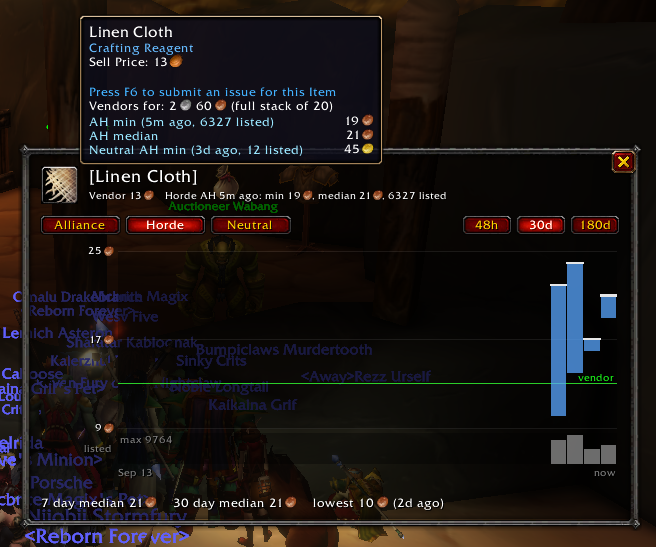

# Auction House DataBase (AHDB) - WoW Forever edition

AHDB scans the whole auction house, keeps a price history per item that you can see as a graph (Alt-click any item),
shows vendor and AH prices in item tooltips and warns you before you list something for less than a vendor would pay.

The Classic / Mists / retail versions (and their MoLib based code) are on the
[legacy](https://github.com/mooreatv/AuctionDB/tree/legacy) branch.

## Price history graph

**Alt-click any item** (bags, bank, chat links, AH lists, merchant...) or use `/ahdb price <item>` to see its price
history, even away from the AH:

- Each bar goes from the lowest to the median unit price: per scan for the last 48 hours, per day for the last 30 or
  180 days. Hover for the values.
- The quantity listed is under the graph, the vendor price is the green line.
- 7 and 30 day median prices and the lowest price seen, for each auction house (Alliance, Horde, Neutral).
- Every scan is kept 2 days, then one summary per day for 180 days, so the saved data stays small even when scanning
  every 15 minutes.

## Sharing prices between your accounts

Saved data is per WoW account. To use the prices one account scanned on another one's characters (e.g. one
character parked at the AH, another one out in the world):

- `/ahdb trust <First Last>` (or target the character and `/ahdb trust`) on both sides, then:
- Item tooltips and the price window ask an online trusted character for prices newer than yours ("asking ...")
  and add them to your price history.
- **Live** button of the price window (or `/ahdb live <item>`): a trusted character at an open AH searches the item
  and sends its current min / median price and quantity listed.
- Only between characters of the same faction (whispers don't cross factions); the neutral AH prices are
  shared either way. `/ahdb trust` lists who's trusted and online.
- Out of the game, [ahdbmerge](https://github.com/mooreatv/AHDBapp#merging-price-history-between-your-wow-accounts-wow-forever)
  merges the price history of all the accounts of a WoW install.

## What does it do?

- Opening the auction house starts a full scan (Blizzard allows one every 15 minutes per game session; hold Shift to
  skip it). The "AHDB Scan" button above the AH shows when the next scan is possible.
- Prices are kept separately for the Alliance, Horde and neutral (goblin) auction houses.
- Item tooltips show the vendor price per unit (the game's own line is for the whole stack) and the last scan's
  AH min and median price, and how many are listed. Also install [BVP](https://www.curseforge.com/wow/addons/better-vendor-price)
  (BetterVendorPrice) for full stack and stack size vendor prices: BVP then shows the vendor lines and AHDB the AH
  ones, no duplicates.
- On the AH sell page, the price turns red with a warning when, after the AH cut, you'd get less than a vendor pays.
- Items vendors refuse even though they have a sell price are learned and get no vendor price (`/ahdb unsellable`).
- Price history graph of any item: Alt-click it or `/ahdb price <item>` (see above).
- Optionally ("Record full scans" in the options) it also keeps every auction of the last scans, which
  [AHDBapp](https://github.com/mooreatv/AHDBapp) can load into a database for your own analysis of the economy.
- `/ahdb bug` shows a copyable log for bug reports. `/ahdb` lists all commands.

## More information

Get the binary release using [curseforge](https://www.curseforge.com/wow/addons/auction-house-database)
client or other addon manager or on wowinterface.

The source of the addon resides on https://github.com/mooreatv/AuctionDB

Releases detail/changes are on https://github.com/mooreatv/AuctionDB/releases
